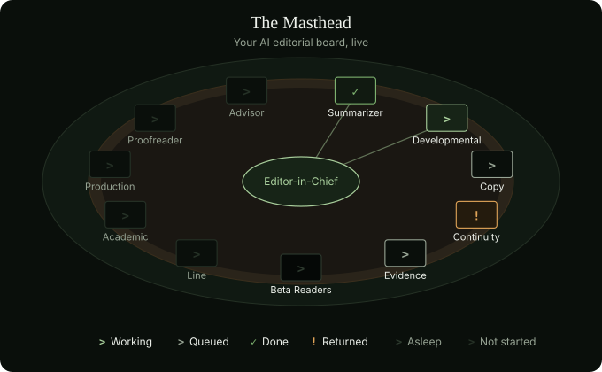

# Publishify Masthead

<p align="center"></p>

**Your AI editorial board.** Masthead reads your book the way a publishing house staff would, gives evidence-based notes and shows the result on a visual dashboard. It never changes your text and never passes a verdict: the decisions stay yours.

> **Early access.** Using Masthead needs a licence linked to your Google account. Write to info@publishify.app to request one.

## What you get

- **Editor:** reads each section once and gives notes on structure, pacing, language and spelling.
- **Auditor:** finds contradictions in age, date, place and objects, with evidence from two places, and maps the book onto [The Wayfarer's Seven Stages](docs/wayfarers-seven-stages.tr.md) (in Turkish).
- **Reader Panel:** simulates where a reader grew curious and where they drifted away.
- **Dashboard:** seven stages on one ring, up to three main decisions, section status and every note. It opens offline and can be printed.

Scripts do the routine work without spending tokens: measuring, quote checks, frequent spelling errors, the scorecard and the dashboard. A section that has not changed is not read again.

## Your book stays with you

The AI that reads your book runs on your own Claude account. Your full text and section summaries stay on your computer. Only editorial notes, quotes of up to 25 words and counts reach the Masthead server, which runs no AI.

## Requirements

- [Claude Code](https://claude.com/claude-code) and a Claude account
- Node.js
- A Masthead licence

## Install

In Claude Code:

```
/plugin marketplace add publishify/masthead
/plugin install masthead@publishify
```

## Use

Open Claude in the folder that holds your book, then run:

```
/masthead:review your-book.docx novel
/masthead:status
```

A browser opens once for sign-in with Google. Supported files are `.md`, `.txt` and `.docx`. The report is saved as `masthead-dashboard.html` in the same folder.

AI can make mistakes, so read every note with your own judgement.

## Develop

```
pnpm install
pnpm check
```

## License

MIT with the Commons Clause: you may use, modify and share this plugin, but you may not sell it. See [LICENSE](LICENSE).

Part of [Publishify](https://publishify.app).
