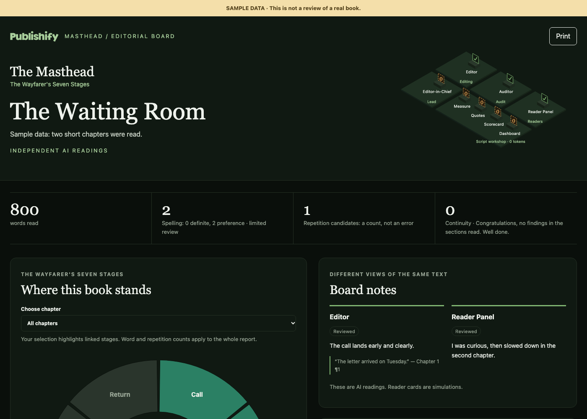

<p align="center"></p>

<p align="center"></p>

<h1 align="center">Publishify Masthead</h1>

<p align="center"><strong>An AI editorial board for your book.</strong></p>

<p align="center"></p>

Masthead reads your book the way a publishing house staff would, gives notes backed by quotes from your text, and shows the result on a visual dashboard. It never changes your text and never passes a verdict: the decisions stay yours.

> **Early access.** Masthead needs a licence. Write to info@publishify.app to request one.

[Türkçe kurulum rehberi](docs/install.tr.md)

## What you get

| Reading          | What it does                                                                                                                                                                 |
| ---------------- | ---------------------------------------------------------------------------------------------------------------------------------------------------------------------------- |
| **Editor**       | Reads each section once: structure, pacing, language and spelling                                                                                                            |
| **Auditor**      | Finds contradictions in age, date, place and objects, with evidence from two places, and maps the book onto [The Wayfarer's Seven Stages](docs/wayfarers-seven-stages.tr.md) |
| **Reader Panel** | Simulates where a reader grew curious and where they drifted away                                                                                                            |

<p align="center"></p>

Scripts do the routine work without spending tokens: measuring, quote checks, frequent spelling errors, the scorecard and the dashboard. A section that has not changed is not read again.

## Your book stays with you

The AI that reads your book runs on your own Claude account. Your full text and section summaries stay on your computer. Only editorial notes, quotes of up to 25 words and counts reach the Masthead server, which runs no AI. See the [privacy policy](https://publishify.app/privacy/).

## Install, step by step

No programming needed. You will paste a few lines and press Enter.

### 1. What you need

- A paid [Claude](https://claude.com/pricing) account
- [Claude Code](https://claude.com/claude-code): follow the install steps on that page
- [Node.js](https://nodejs.org): download the version marked LTS and install it like any other app
- A Masthead licence, linked to the email of your Google account

### 2. Open Terminal

- **Mac:** press `Cmd` + `Space`, type `Terminal`, press Enter.
- **Windows:** open the Start menu, type `Terminal`, press Enter.

### 3. Go to your book's folder

Type `cd`, then a space, then drag your book's folder into the Terminal window and press Enter. Then start Claude:

```
claude
```

### 4. Add Masthead

Inside Claude, paste these one at a time and press Enter after each:

```
/plugin marketplace add publishify/masthead
```

```
/plugin install masthead@publishify
```

Choose **Install for you**. Then type `/exit`, run `claude` again, and Masthead is ready.

### 5. Review your book

```
/masthead:review my-book.docx novel
```

Use your own file name. The first time, a browser opens: choose **Continue with Google** and sign in with the account that holds your licence.

When the review is done, the report opens by itself. It is saved in the same folder as `masthead-dashboard.html`. To see it again later:

```
/masthead:status
```

**Files you can use:** Word (`.docx`), EPUB without copy protection (`.epub`), Markdown (`.md`) and plain text (`.txt`).

**Kinds of book:** `novel`, `novella`, `short-story`, `memoir`, `biography`, `play`. In beta: `essay`, `flash-fiction`, `non-fiction`.

## If something goes wrong

| What you see                              | What to do                                                                          |
| ----------------------------------------- | ----------------------------------------------------------------------------------- |
| `claude: command not found`               | Install Claude Code, then close and reopen Terminal                                 |
| `node: command not found`                 | Install Node.js, then close and reopen Terminal                                     |
| It says there is no access (`NO_LICENSE`) | Sign in with the Google account that holds your licence, or request one             |
| It cannot find your file                  | Make sure Claude was started in your book's folder                                  |
| It stops at your usage limit              | Wait until the limit resets and run the same command; finished work is not repeated |

## Update or remove

Type `/plugin` in Claude, choose **masthead**, then update or uninstall it.

AI can make mistakes, so read every note with your own judgement.

## For developers

```
pnpm install
pnpm check
```

## License

MIT with the Commons Clause: you may use, modify and share this plugin, but you may not sell it. See [LICENSE](LICENSE).

Part of [Publishify](https://publishify.app).
